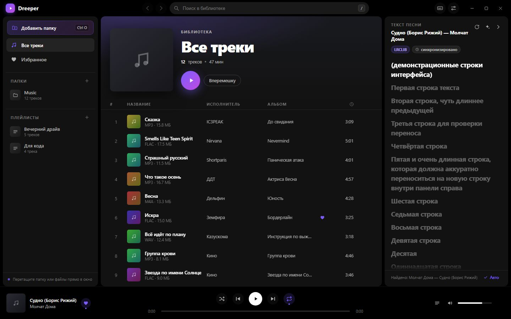

# Dreeper

Музыкальный плеер для Windows в стиле Spotify: локальные папки и плейлисты, панель текста справа, ИИ-агент для поиска текстов. Написан на Rust + Tauri v2 (WebView2), интерфейс — HTML/CSS/JS без сборщика.



## Возможности

- **Библиотека из папок.** «Добавить папку» (или перетащить папку/файлы в окно) — Dreeper рекурсивно читает теги, обложки, длительность. MP3, FLAC, WAV, M4A, AAC, OGG, OPUS, WMA, AIFF, ALAC.
- **Плейлисты.** Создание, переименование, удаление; добавление треков через меню «⋯» у трека.
- **Избранное** отдельным разделом.
- **Панель текста справа.** Точный текст из открытых баз (LRCLIB, Lyrics.ovh), с синхронизацией по времени — активная строка подсвечивается и прокручивается автоматически. Клик по строке перематывает трек.
- **ИИ-агент** (Ollama локально или GigaChat): уточняет исполнителя и название по «грязному» имени файла, повторяет поиск текста и, если текста нет в базах, показывает справку о треке.
- **Плеер:** очередь, перемешивание, повтор (список/трек), громкость, перемотка мышью, системные медиа-клавиши Windows.
- **Горячие клавиши** — см. ниже или кнопку с клавиатурой в правом верхнем углу.

## Сборка

### Вариант 1: GitHub Actions (не требует ничего ставить локально)

В репозитории лежит `.github/workflows/build.yml`. Он собирает приложение на `windows-latest` (там MSVC уже установлен) и кладёт в артефакты:

- `Dreeper-windows-x64-portable.zip` — просто распаковать и запустить `Dreeper.exe`;
- `src-tauri/target/release/bundle/nsis/*.exe` — установщик.

Как получить сборку:

1. Запушить проект в GitHub (ветка `main`).
2. Вкладка **Actions** → workflow **build-windows** → **Run workflow** (или просто дождаться сборки после пуша).
3. Скачать артефакт **Dreeper-windows-x64** внизу страницы запуска.

Если создать тег `v0.1.0` и запушить его — файлы дополнительно прикрепятся к GitHub Release.

### Вариант 2: локально через MinGW (без Visual Studio / C++ Build Tools)

Нужны: Rust (rustup) и MinGW-w64.

```powershell
winget install BrechtSanders.WinLibs.POSIX.UCRT
rustup target add x86_64-pc-windows-gnu

# путь к MinGW в PATH (подставьте свой, см. папку установки WinLibs)
$env:PATH = "C:\Program Files\WinLibs\mingw64\bin;$env:PATH"

cargo build --release --target x86_64-pc-windows-gnu `
  --manifest-path src-tauri/Cargo.toml
```

Готовый файл: `src-tauri/target/x86_64-pc-windows-gnu/release/dreeper.exe` — одиночный exe, интерфейс внутри.

### Вариант 3: локально с MSVC

Если установлены Visual Studio Build Tools с компонентом «C++ build tools»:

```powershell
cargo build --release --manifest-path src-tauri/Cargo.toml
```

Файл: `src-tauri/target/release/dreeper.exe`.

### Запуск в разработке

```powershell
cargo run --manifest-path src-tauri/Cargo.toml
```

Debug-сборка открывает консоль с логами — удобно для отладки.

### Требования

- Windows 10/11, WebView2 Runtime (в Windows 11 уже есть, в Windows 10 — обычно тоже).
- Интернет нужен только для поиска текстов. Плеер полностью офлайн.

## Горячие клавиши

| Действие | Клавиши |
| --- | --- |
| Играть / пауза | `Space` |
| Следующий / предыдущий | `Ctrl →` / `Ctrl ←` |
| Перемотка ±5 сек (настраивается) | `→` / `←` |
| Громкость | `↑` / `↓` |
| Без звука | `M` |
| Перемешать | `S` |
| Повтор (список → трек → выкл.) | `R` |
| В избранное | `F` |
| Панель текста | `L` |
| Найти текст заново | `=` |
| Поиск по библиотеке | `/` или `Ctrl F` |
| Добавить папку | `Ctrl O` |
| Новый плейлист | `Ctrl N` |
| Настройки | `Ctrl ,` |
| Справка по клавишам | `?` |
| Закрыть окно/меню | `Esc` |

Глобальные (работают, когда окно не в фокусе): `Alt Space` — плей/пауза, `Alt Ctrl →/←` — треки, `Alt ↑/↓` — громкость.

## ИИ-агент

Настройки → «ИИ-агент для текстов».

**Ollama (локально, бесплатно):**

```powershell
winget install Ollama.Ollama
ollama pull qwen2.5:7b
```

Адрес `http://127.0.0.1:11434`, модель — та, что скачали. Кнопка «Проверить подключение».

**GigaChat (облако Сбера):** нужен «Ключ авторизации» из личного кабинета GigaChat (Base64 `client_id:client_secret`). Вставьте его в настройках, выберите провайдера `GigaChat`. Если сервер отдаёт ошибку сертификата — установите в Windows корневой сертификат Минцифры (Russian Trusted Root CA), приложение использует системное хранилище сертификатов.

Что именно делает агент:

1. Нормализует название и исполнителя (например, из `05_-_molchat_doma_-_sudno.mp3`).
2. Повторяет поиск в LRCLIB с уточнёнными данными.
3. Если текста нет ни в одной базе и включена галочка «показывать справку от ИИ» — пишет краткий разбор трека (жанр, год, о чём песня). Дословный текст ИИ не генерирует: это гарантированно привело бы к выдуманным строкам.

## Где хранятся данные

`%APPDATA%\com.dreeper.player\state.json` — папки, плейлисты, избранное, настройки, кэш текстов. Музыка остаётся на месте, ничего не копируется.

## Структура проекта

```
ui/                      интерфейс: index.html, styles.css, app.js
src-tauri/src/main.rs    команды Tauri
src-tauri/src/scan.rs    обход папок, теги, обложки (lofty)
src-tauri/src/store.rs   state.json
src-tauri/src/lyrics.rs  поиск текста: LRCLIB, Lyrics.ovh
src-tauri/src/ai.rs      Ollama / GigaChat
src-tauri/tauri.conf.json, capabilities/
.github/workflows/build.yml
```
